<div align="center">

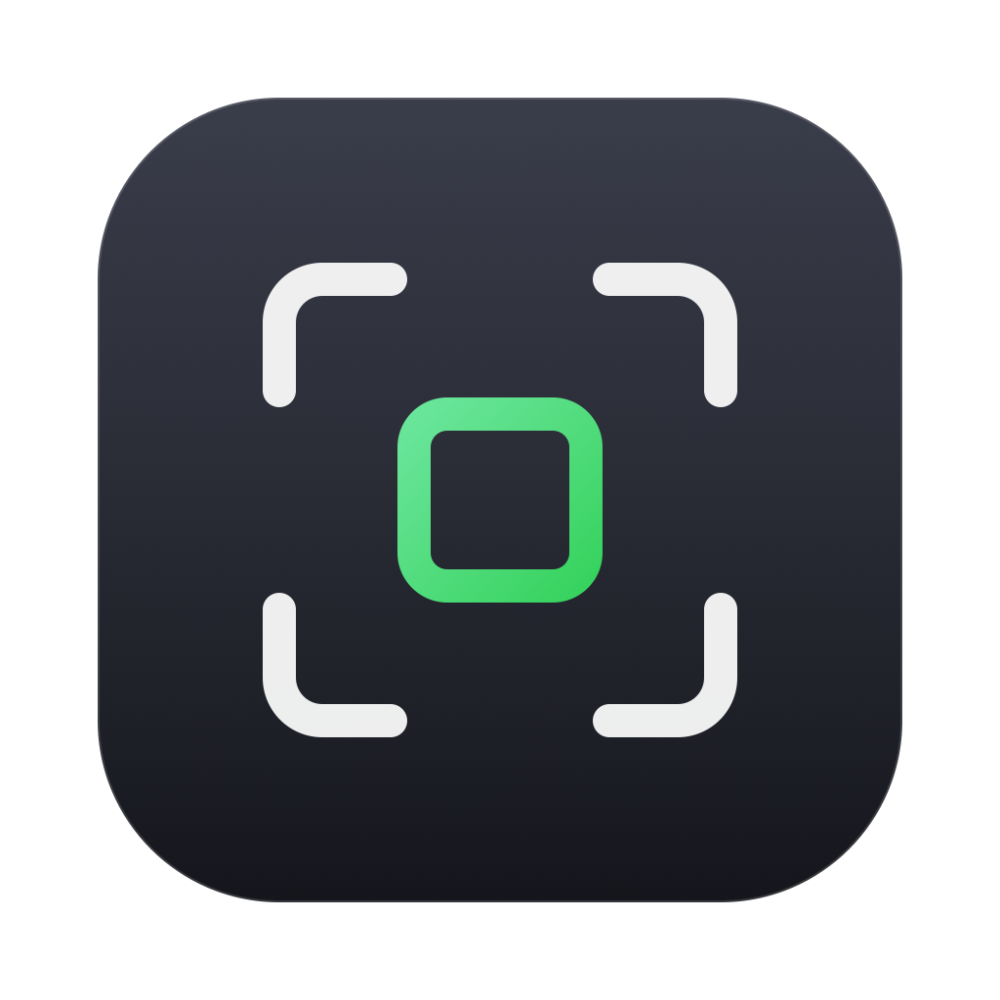

# Sift

**Fast photo culling. No waiting for RAW decoding.**

Open a folder, flip through, flag, rate, try looks and export. JPEG and RAW from every major maker.<br>
For RAW files Sift shows the preview the camera wrote into the file, so the next photo is one key press away.

[](https://github.com/kinyokun/sift/releases/latest)
[](#download)
[](https://github.com/kinyokun/sift/actions/workflows/ci.yml)
[](LICENSE)

[**Download for macOS / Windows**](https://github.com/kinyokun/sift/releases/latest) · [Features](#no-waiting-for-raw-decoding) · [Performance](#performance) · [Build](#build) · [中文](README.md)

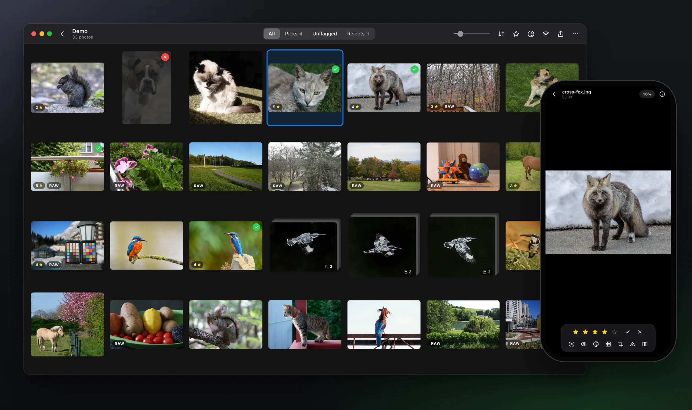

</div>

<table>
<tr>
<td width="25%" valign="top"><b>Fast</b><br>About 10 ms to the next photo. Sift uses the preview the camera already made instead of decoding the RAW; a folder of nearly a thousand photos fills the first screen in 0.6 s.</td>
<td width="25%" valign="top"><b>Check focus at a glance</b><br>One key zooms to the eyes (people, cats, dogs, birds, horses…), and the camera's own AF points are drawn on the photo.</td>
<td width="25%" valign="top"><b>Originals stay untouched</b><br>Ratings go into the XMP inside the file, or a <code>.xmp</code> sidecar when they don't fit; RAW files are never rewritten.</td>
<td width="25%" valign="top"><b>Runs everywhere</b><br>One interface on macOS, Windows, iOS and Android, in English and Chinese, at home with a keyboard, trackpad or touch screen.</td>
</tr>
</table>

## No waiting for RAW decoding

Most viewers decode the whole sensor readout when they open a RAW, 0.5 to 2 seconds a photo. Sift reads the full-size JPEG preview the camera stored inside the RAW, which takes under a millisecond to find, so you can hold `→` and keep going. Once you stop for 140 ms the full-resolution image is swapped in, so 100% views are sharp too.

<p align="center">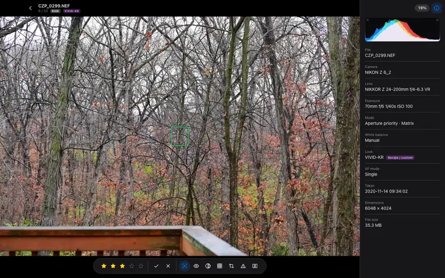</p>

<p align="center">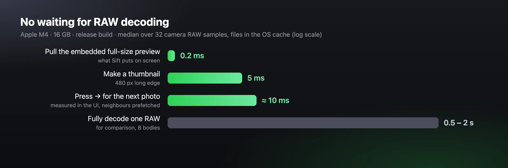</p>

## See the focus

Press `E` to zoom to the eyes. Sift looks for faces first; when there is no person, or the AF point is not on any face, it looks for animals (cats, dogs, birds, horses, sheep, cows, bears and more, ten kinds in all) and finds their eyes with a pose model. The models run on your machine; photos never leave it.

<table>
<tr>
<td width="50%">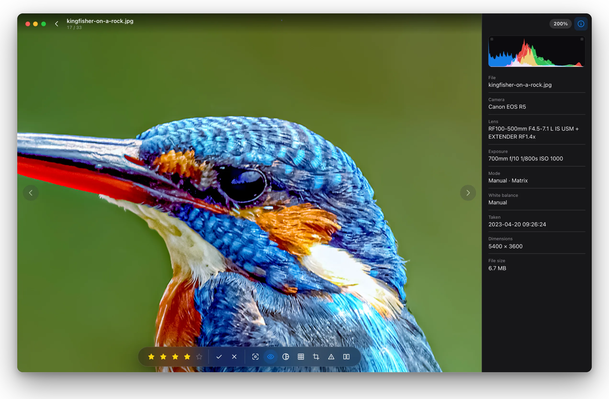</td>
<td width="50%">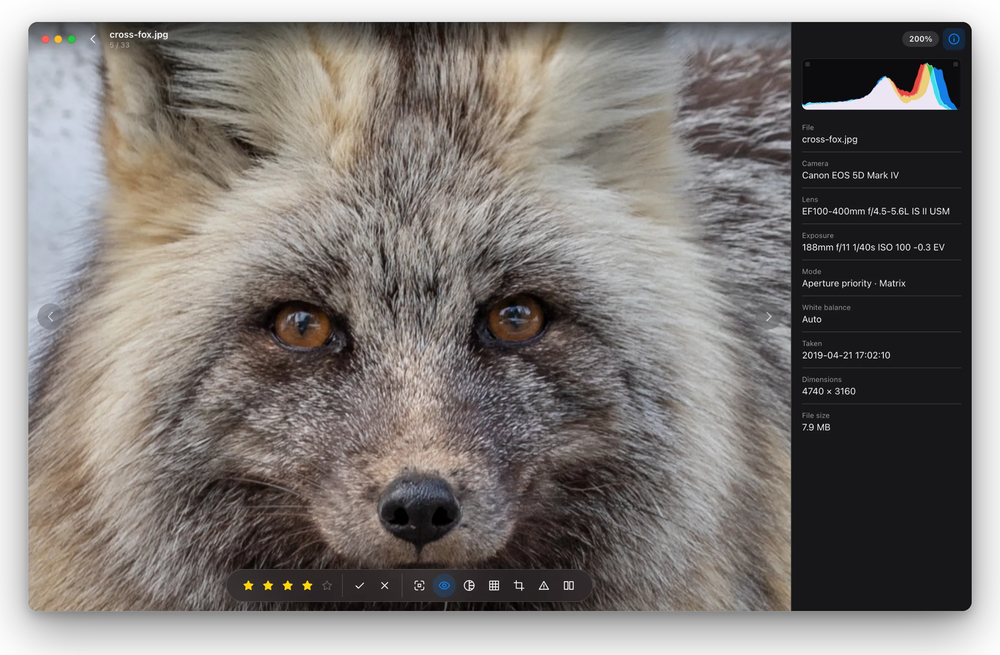</td>
</tr>
</table>

Press `F` to show the AF points that Nikon, Canon, Sony and Fujifilm bodies record, placed correctly for orientation and crop. The info panel next to it lists the camera, lens, exposure, focus mode, Picture Control or film simulation, and a histogram.

<p align="center">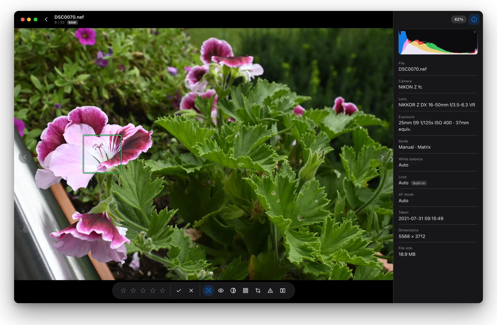</p>

## Bursts, pixel shift and Live Photos

Bursts and pixel-shift series fold into one grid cell with a frame count; rating, flagging and exporting it covers the whole stack. In the viewer a filmstrip shows every frame of the stack, and `↑` / `↓` jump to the previous or next stack. Nikon bodies are grouped exactly by the series number they write into the file; other makers by drive mode and the time between frames.

On macOS a burst can become a Live Photo: drag the ends of the timeline to choose frames, click one as the cover, and it plays at the burst's real rate (up to 120 frames a second). Drop the result into Photos and it is a Live Photo.

<table>
<tr>
<td width="50%">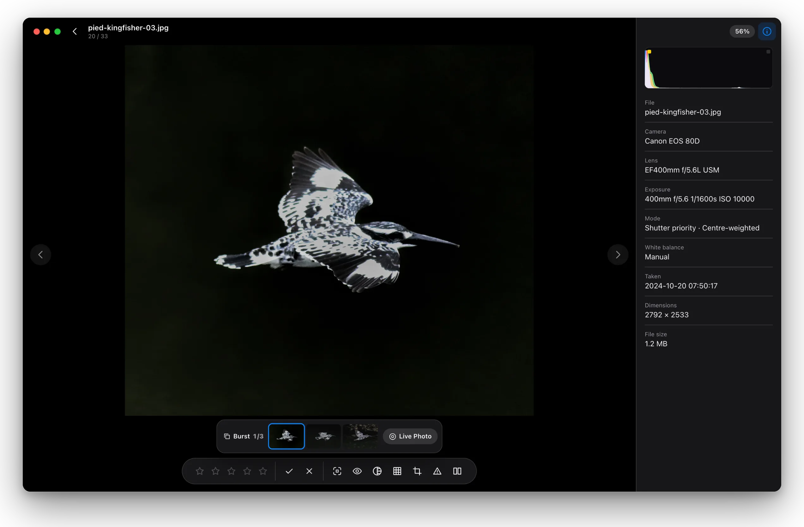</td>
<td width="50%">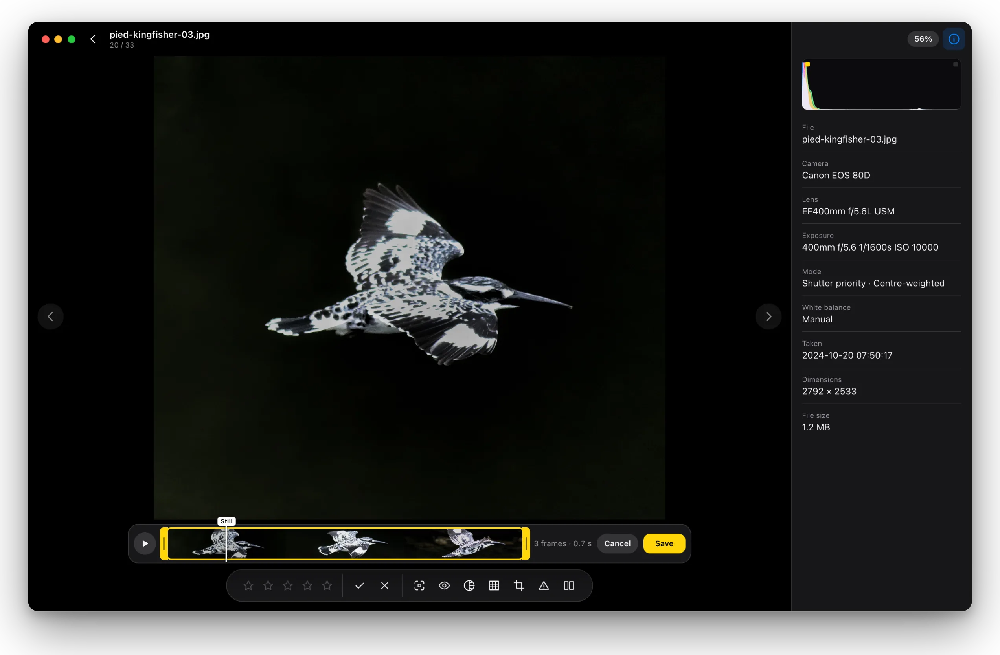</td>
</tr>
</table>

## Looks

Import `.cube`, `.3dl`, HaldCLUT `.png` and Nikon `.NP3` looks. Press `W` to see every look on one photo at once and click to apply it; select several photos in the grid to apply it to all of them. Shots with a RAW are rendered from the RAW, so looks never stack on the in-camera Picture Control. For photos taken with a Nikon Imaging Cloud or custom recipe, you can save that recipe as an NP3 and use it on other photos.

<p align="center">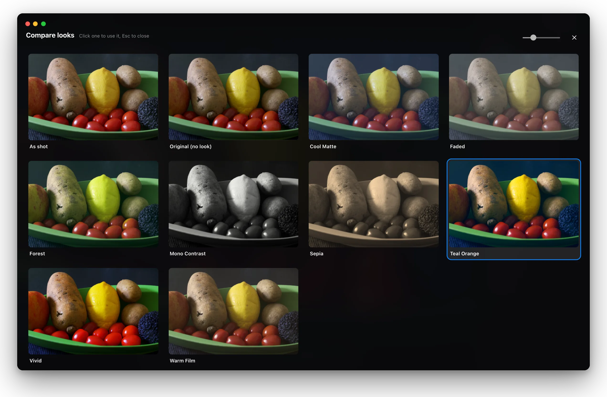</p>

**Nikon's own engine**: the official macOS and 64-bit Windows installers bundle Nikon's NEF/NRW Image SDK, so NEF originals and NP3 looks, custom curves included, are developed by Nikon's own engine and match the camera. It ships with Sift under Nikon's licence and is not open source; see [NIKON_SDK_TERMS.md](NIKON_SDK_TERMS.md). Builds from source don't include it: NP3 looks are then approximated from their settings and everything else works the same.

## Compare and exposure

Press `C` to compare photos side by side: two, three or four at a time (`Shift+C` switches, four make a 2 × 2 grid). Each pane is controlled on its own: click its title bar to put any photo of the folder in it, step it with its own arrows, or click a frame in the burst strip to show that frame in the pane you are on; zoom and pan can stay in sync across all of them. Select two to four photos in the grid and press `C` to compare exactly those. Press `H` to mark blown highlights (red) and crushed shadows (blue), using the same thresholds as the histogram.

<table>
<tr>
<td width="50%">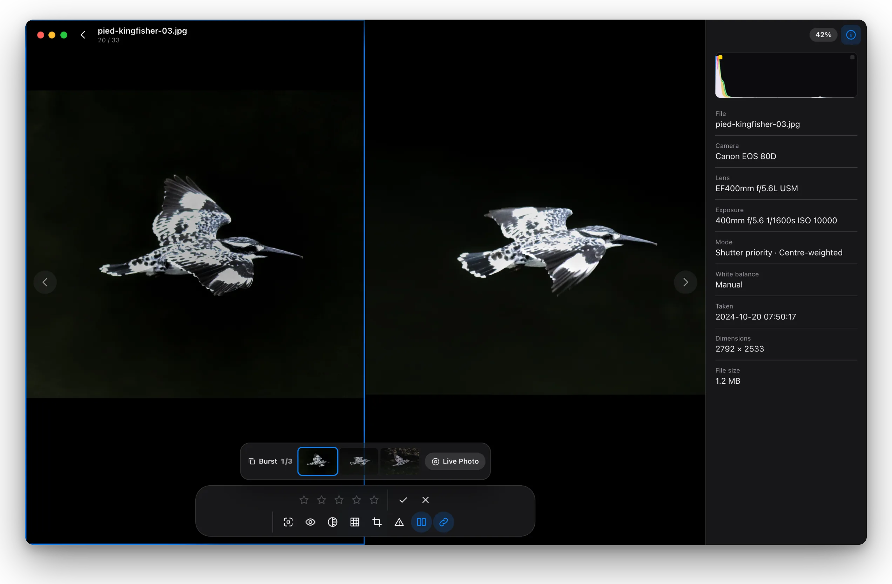</td>
<td width="50%">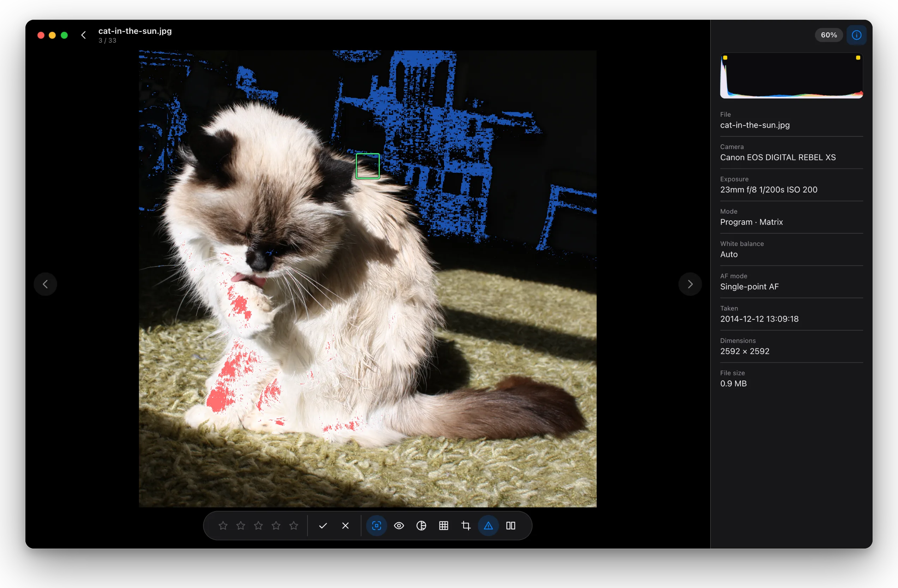</td>
</tr>
</table>

## Pinch from the grid into a photo

`Ctrl` + scroll wheel or a pinch resizes the thumbnails. Keep zooming past two to a row and the photo under the pointer opens; zoom out in the viewer and you are back in the grid.

<p align="center">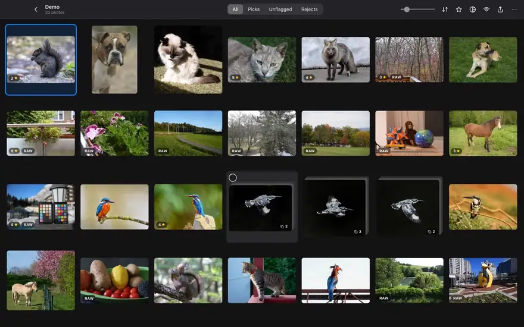</p>

## Export and send to a phone

Copy your picks, rename them by a pattern, find the RAW files that match the JPEGs you chose, or export with an info frame showing the shooting settings. Shots with a look or crop are exported as rendered JPEGs; everything else is copied byte for byte. LAN transfer lets a phone scan a QR code to download the originals, or send its own photos back to the computer.

<p align="center">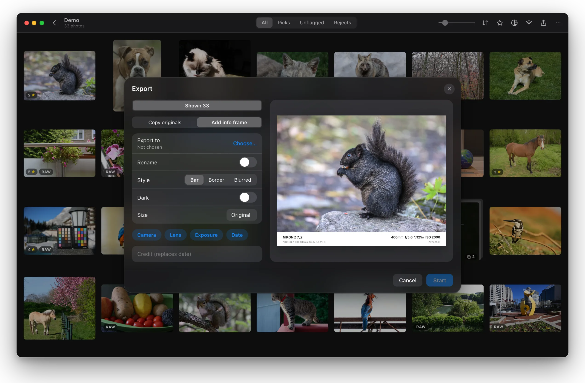</p>

## Windows, light mode and phones

<table>
<tr>
<td width="62%">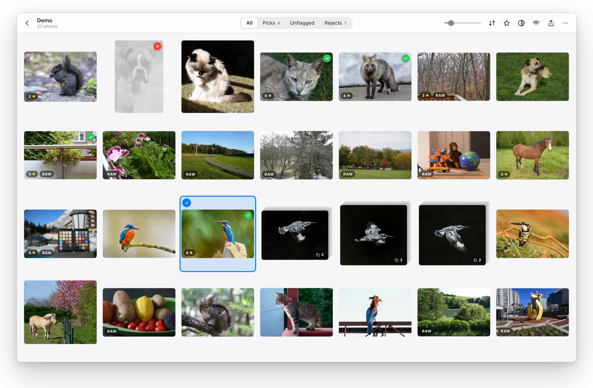</td>
<td width="38%">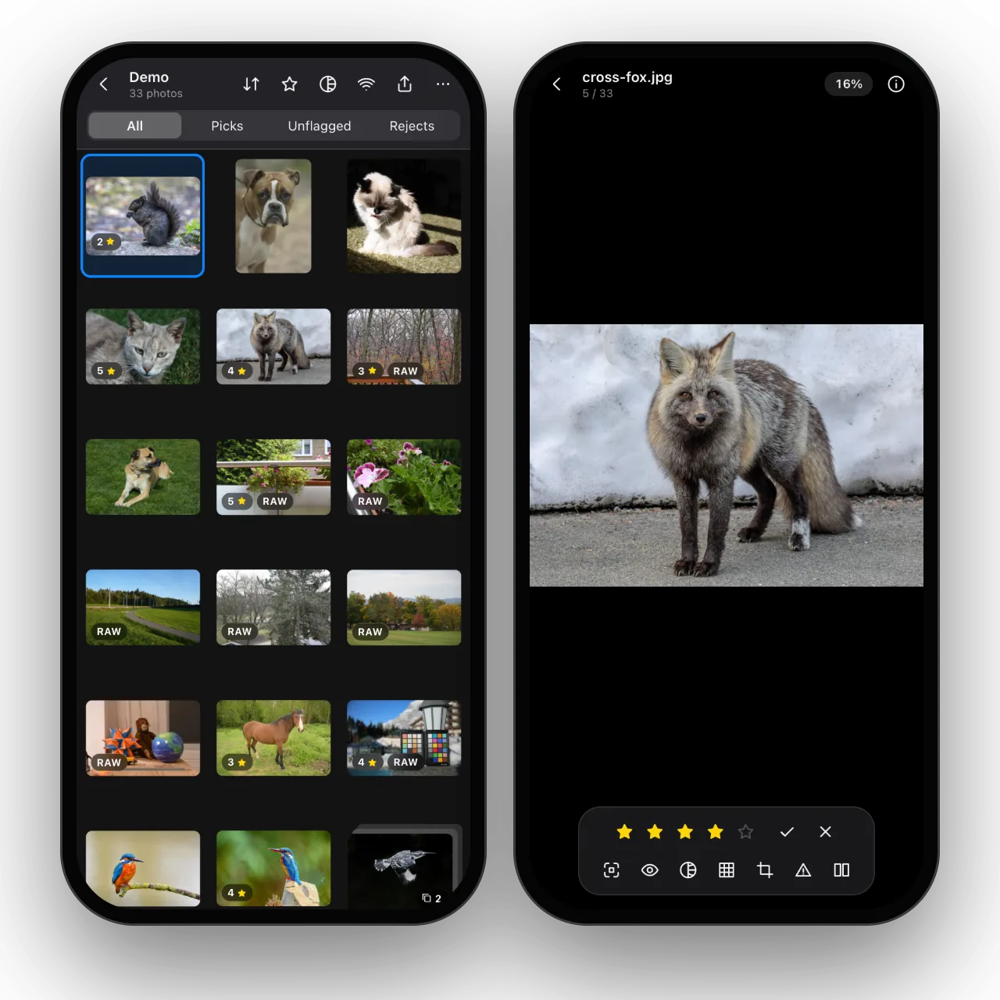</td>
</tr>
</table>

## Performance

Measured with a release build on an Apple M4 (16 GB), photos on an external USB SSD.

| Operation | Time | How it was measured |
| --- | --- | --- |
| Pull the embedded full-size preview out of a RAW | median 0.2 ms, slowest 0.9 ms | 32 Nikon / Canon / Sony samples, files in the OS cache |
| Make a thumbnail (480 px long edge) | median 5 ms, slowest 37 ms | same |
| Open a folder of 990 photos until the first screen of thumbnails is shown | 0.64 s | thumbnail cache cleared, measured in the UI |
| Press `→` in the viewer for the next photo | median 8 ms, slowest 15 ms | 33 RAW and JPEG files mixed, measured in the UI |
| Swap in the full-resolution image after you stop | about 150–170 ms, some RAWs 0.3–0.7 s | includes a deliberate 140 ms wait |
| For comparison: fully decode one RAW and encode a JPEG | 0.5–2.0 s, median 0.8 s | 8 bodies, both rawler and ImageIO |

The UI numbers come from the `perf` session of [`scripts/readme-shots.mjs`](scripts/readme-shots.mjs), the core numbers from `cargo run --release -p sift-core --example probe -- --preview <dir> <files…>`.

## Download

From [Releases](https://github.com/kinyokun/sift/releases/latest):

- macOS (universal, Apple silicon and Intel): `Sift_<version>_universal.dmg`
- Windows 10 / 11 (64-bit): `Sift_<version>_x64-setup.exe`

The installers are not yet notarized by Apple or signed for Windows:

- On macOS, if the first launch says the developer cannot be verified, open System Settings → Privacy & Security and click "Open Anyway" at the bottom
- On Windows, if SmartScreen appears, click "More info → Run anyway"

Every release includes `SHA256SUMS.txt` for checking the files. iOS and Android builds currently have to be built yourself; see [AGENTS.md](AGENTS.md).

## All features

**Culling**

- Grid and full-screen viewer; RAW+JPEG pairs show as one photo. Sort by file name, capture time, rating or file size
- Bursts and pixel-shift series fold into one stack you can step through in the viewer; Live Photos show as one photo and play, and on macOS a burst can be made into one
- Selection: click the circle at a photo's top left, drag a box, Shift for a range, ⌘/Ctrl to add; with several selected, a bar at the bottom rates, flags or applies a look to all of them. On phones, a long press starts selecting
- Pick / reject / 0–5 stars; ratings are written into the XMP inside the file (or a `.xmp` sidecar when that is not possible), and RAW files are never rewritten
- 100% view, eye close-up (people, and the eyes of cats, dogs, birds, horses, sheep, cows and other animals), AF points (Nikon, Canon, Sony, Fujifilm)
- Compare 2, 3 or 4 photos side by side; each pane picks and steps its own photo, burst frames included; zoom and pan can be synced; compare a grid selection directly
- Composition guides and crop preview (applied on export once confirmed)
- Histogram and on-screen clipping warning
- Progress is saved per folder automatically and picked up next time

**Looks**

- Import `.cube`, `.3dl`, HaldCLUT `.png` and Nikon `.NP3`
- Shots with a RAW are rendered from the RAW, never on top of the in-camera look
- Look wall, batch apply, save a photo's Imaging Cloud or custom recipe as an NP3
- Shots with a look or crop are exported as rendered JPEGs; everything else is copied as is

**More**

- Export: copy / rename, find RAW files by name, info frames
- LAN transfer: download originals to a phone by QR code, or send photos back to the computer
- Every shortcut can be changed (Settings → Shortcuts)

<details>
<summary><b>Common shortcuts</b></summary>

- `A` / `D` or `←` / `→`: previous / next photo
- `↑` / `↓`: previous / next stack (bursts, pixel shift)
- `P` / `X` / `U`: pick / reject / unflag
- `0`–`5`: rating
- `Z`: 100% / fit
- `E`: eye close-up
- `F`: AF points
- `N`: original (no look)
- `⌘A` / `⌘D`: previous / next look (Ctrl on Windows)
- `W`: look wall
- `H`: clipping warning
- `C`: compare (in the grid, the 2–4 selected photos)
- `Shift+C`: 2 / 3 / 4 photos in compare
- `Tab`: next pane in compare
- `R`: crop preview
- `I`: info panel
- `Space`: hide the interface
- `` ` ``: all shortcuts

</details>

## Supported formats

| Kind | Formats |
| --- | --- |
| Images | JPEG, PNG, WebP, BMP, GIF, TIFF |
| RAW | CR3, CR2, NEF, NRW, ARW, SR2, SRF, DNG, RAF, ORF, RW2, PEF, 3FR, IIQ, ERF, SRW |
| AF points | Nikon, Canon, Sony, Fujifilm |
| Looks | `.cube`, `.3dl`, HaldCLUT `.png`, Nikon `.NP3` |

For Nikon High Efficiency (HE / HE\*) NEF files, "Original (no look)" uses the system decoder on Apple platforms; the decoders on Windows and Android cannot read them, but you can still cull them from the embedded previews.

## Build

Sift is a Rust core, a Tauri 2 shell and a React/TypeScript interface. You need Rust (stable), Node 22 and pnpm.

```bash
pnpm install
```

```bash
pnpm tauri dev
```

```bash
pnpm tauri build
```

- The macOS installer ends up in `target/release/bundle/dmg/`, the Windows one in `target/release/bundle/nsis/`
- GitHub Actions builds a Windows test installer on every push and pull request; download it from that run's Artifacts
- Releases are built when a `v*` tag is pushed; see [CONTRIBUTING.md](CONTRIBUTING.md#发版)
- Commands for iOS / Android are in [AGENTS.md](AGENTS.md)

## Development

```bash
cargo test -p sift-core
```

```bash
cargo clippy --workspace
```

```bash
pnpm typecheck
```

Layout:

- `crates/sift-core`: the core, independent of the UI. Container parsing, embedded previews, EXIF, AF points, ratings, face and animal detection, RAW development, looks, Nikon's engine client, histogram, export
- `src-tauri`: commands, the `sift://` image protocol, LAN transfer
- `src`: the interface. State is in `lib/store.ts`, text in `lib/i18n.ts` (Chinese / English)

How to inspect a single file, check the UI with headless screenshots, and the pitfalls to avoid are in [AGENTS.md](AGENTS.md). How the images on this page are made is in [docs/readme](docs/readme/README.md). To contribute, see [CONTRIBUTING.md](CONTRIBUTING.md); report security issues privately as described in [SECURITY.md](SECURITY.md).

## Credits

Sift grew out of [Anicrop Studio](https://github.com/R4ksh4/AnicropStudio) (R4ksh4, Apache-2.0), a Windows culling workbench built for convention photo sets. Sift rewrote it in Rust and TypeScript and brought it to macOS, Windows, iOS and Android; the eye close-up, camera AF points, in-file ratings, finding RAW files from picks, compare, composition guides and info frames all come from Anicrop Studio's features and ideas.

- [Anicrop Studio](https://github.com/R4ksh4/AnicropStudio): where Sift started, by R4ksh4 and contributors (Apache-2.0)
- [rawler / dnglab](https://github.com/dnglab/dnglab): RAW development (LGPL-2.1)
- [tract](https://github.com/sonos/tract): runs the detection models locally
- [Tauri](https://tauri.app), [React](https://react.dev), [zustand](https://github.com/pmndrs/zustand)
- [raw.pixls.us](https://raw.pixls.us): sample files for testing
- The animal photos in the screenshots are CC0 images from Wikimedia Commons; authors are listed in [docs/readme](docs/readme/README.md#照片来源)
- Models and fonts are listed below

## License

Sift is open source under [GPL-3.0-or-later](LICENSE): you may use, modify and redistribute it freely, but if you distribute a modified version or a work based on Sift, it must also be released under GPL-3.0 with complete source code. Copyright, attribution and additional permissions are in [NOTICE](NOTICE), third-party components in [THIRD_PARTY_NOTICES.md](THIRD_PARTY_NOTICES.md); every release includes `THIRD-PARTY-LICENSES.html` with the full licence texts of all Rust dependencies.

Anicrop Studio is Apache-2.0, which allows derivative works to be distributed under GPL-3.0; the dependencies used (including LGPL-2.1 rawler and several MPL-2.0 crates) are all compatible with GPL-3.0.

Nikon's SDK belongs to Nikon and is bundled in the official installers with Nikon's permission. It is not covered by the GPL; its terms are in [NIKON_SDK_TERMS.md](NIKON_SDK_TERMS.md). The `sift-nikon` program that drives it cannot be published because of the confidentiality terms of Nikon's licence; it is a separate executable that Sift talks to over a local socket. NOTICE adds a permission under section 7 of GPL-3.0 that allows this combination to be distributed. Nikon, Canon, Sony, Fujifilm and others are trademarks of their respective owners; Sift is not affiliated with them.

Models and fonts shipped with the app (in `crates/sift-core/assets`):

- YuNet face detection (OpenCV Zoo, MIT)
- YOLOX-Tiny object detection (Megvii, Apache-2.0), used to find animals
- RTMPose-m AP-10K animal keypoints (OpenMMLab MMPose, Apache-2.0; the AP-10K dataset is CC BY 4.0), used to find animals' eyes
- Inter font (SIL OFL 1.1), used for info frames
