<div align="center">

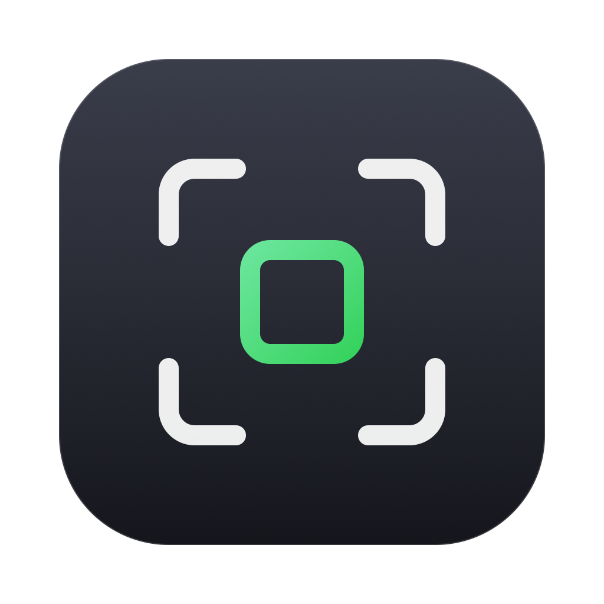

# Sift

**快速选片，翻页不等解码。**

打开一个文件夹，翻看、标记、打星、套滤镜、导出。JPEG 和各家 RAW 都行，<br>
RAW 直接用相机写在文件里的预览图，所以按一下就是下一张。

[](https://github.com/kinyokun/sift/releases/latest)
[](#下载)
[](https://github.com/kinyokun/sift/actions/workflows/ci.yml)
[](LICENSE)

[**下载 macOS / Windows 版**](https://github.com/kinyokun/sift/releases/latest) · [功能](#翻页不等解码) · [性能](#性能) · [构建](#构建) · [English](README.en.md)

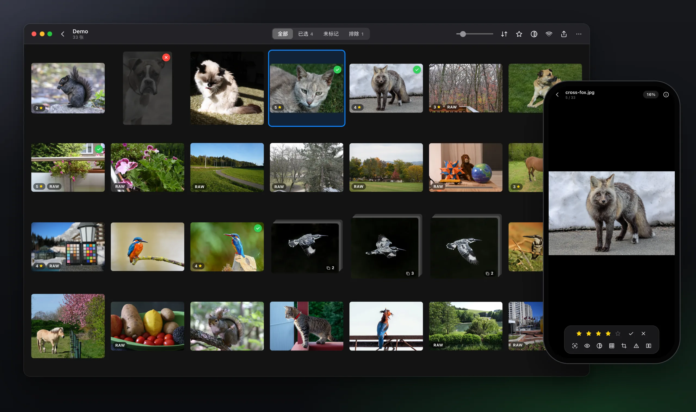

</div>

<table>
<tr>
<td width="25%" valign="top"><b>快</b><br>翻到下一张约 10 ms。不解码 RAW，直接用相机写好的预览图，近千张的文件夹 0.6 秒出第一屏。</td>
<td width="25%" valign="top"><b>看得清焦点</b><br>一键放大到眼睛（人、猫、狗、鸟、马……），原厂对焦点直接画在照片上。</td>
<td width="25%" valign="top"><b>不动原片</b><br>星级写进文件里的 XMP，写不进就写 <code>.xmp</code> 旁车文件；RAW 一个字节都不改。</td>
<td width="25%" valign="top"><b>到处能用</b><br>macOS、Windows、iOS、Android 同一套界面，中文 / 英文，键盘、触控板、触屏都顺手。</td>
</tr>
</table>

## 翻页不等解码

大多数看图软件打开 RAW 时要先解码整张传感器数据，一张 0.5 到 2 秒。Sift 读的是相机自己写在 RAW 里的全尺寸 JPEG 预览，在文件里找到它不到 1 毫秒，所以按住 `→` 就能一路翻下去；停下 140 ms 后才换上全尺寸原图，放大到 100% 也是清楚的。

<p align="center">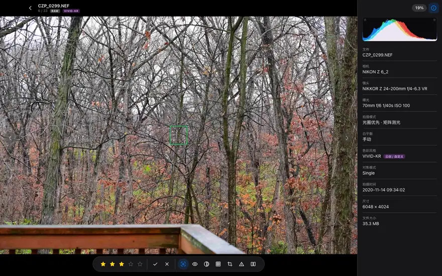</p>

<p align="center">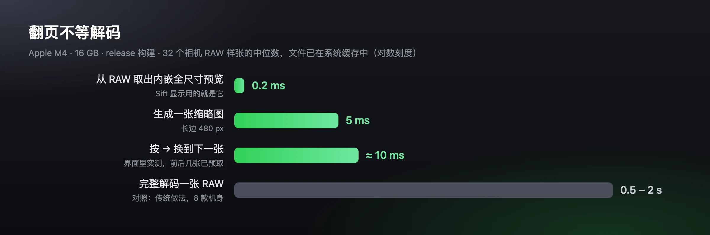</p>

## 看清焦点

按 `E` 放大到眼睛。先找人脸；没有人，或者对焦点不在任何一张脸上，就去找动物：猫、狗、鸟、马、羊、牛、熊等十类，再用姿态模型定位它们的眼睛。识别模型都在本机运行，照片不会离开你的电脑。

<table>
<tr>
<td width="50%">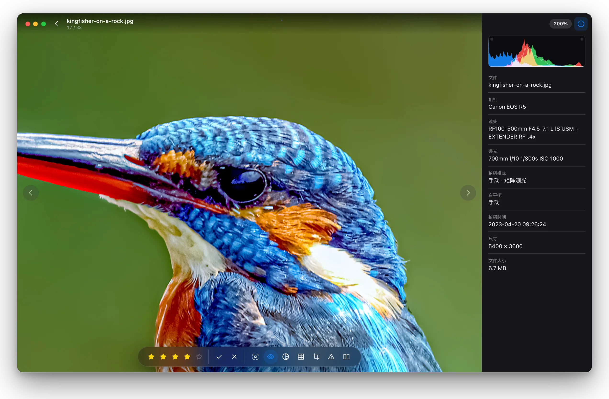</td>
<td width="50%">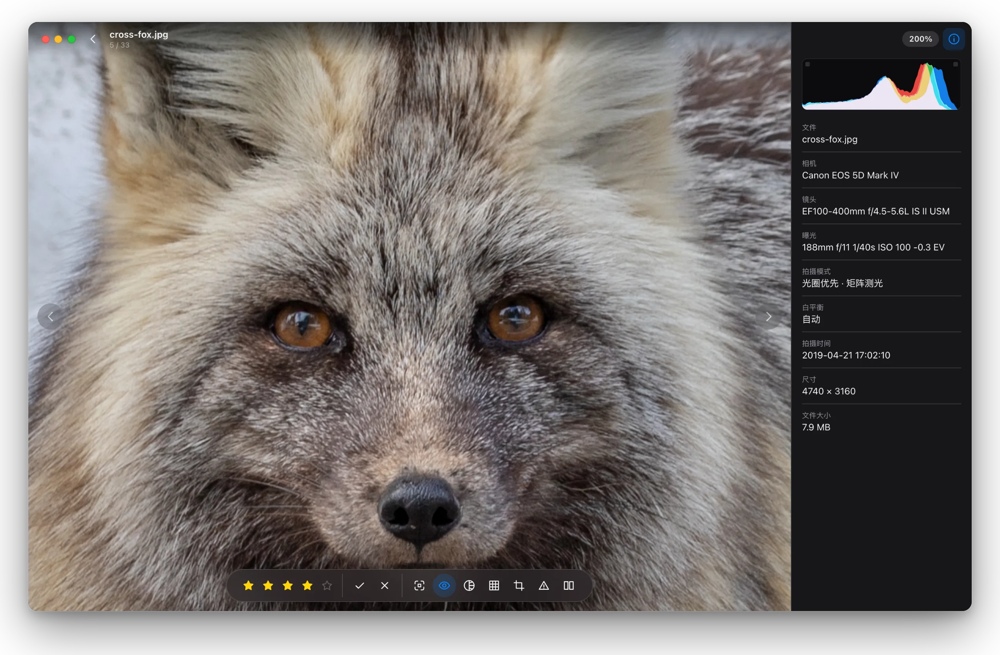</td>
</tr>
</table>

按 `F` 显示对焦点：尼康、佳能、索尼、富士的原厂对焦点记录，按照片方向和裁切画在画面上。旁边的信息栏列出相机、镜头、曝光、对焦模式、色彩风格和直方图。

<p align="center">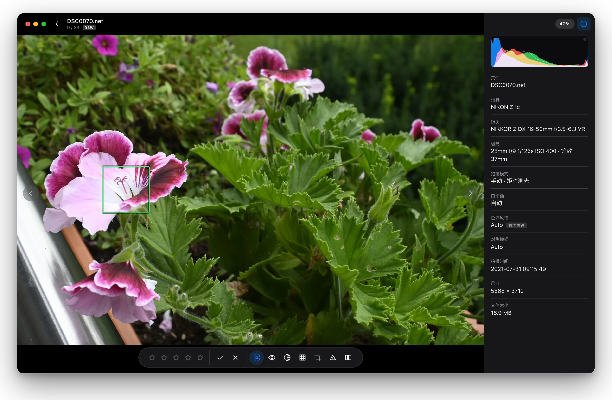</p>

## 连拍、像素偏移与实况照片

连拍和像素偏移的一组在列表里叠成一格，标出张数；打星、标记、导出时算整组。查看页下方的胶片条显示组内每一张，`↑` / `↓` 跳到上一组 / 下一组。尼康机身按它写进文件的连拍编号精确分组，其他品牌按驱动模式和拍摄间隔判断。

在 macOS 上，一组连拍可以直接做成实况照片：在时间条上拖两端选帧、点一帧当封面，按连拍的实际速度播放（最高 120 张/秒），保存后拖进“照片”就是一张实况照片。

<table>
<tr>
<td width="50%">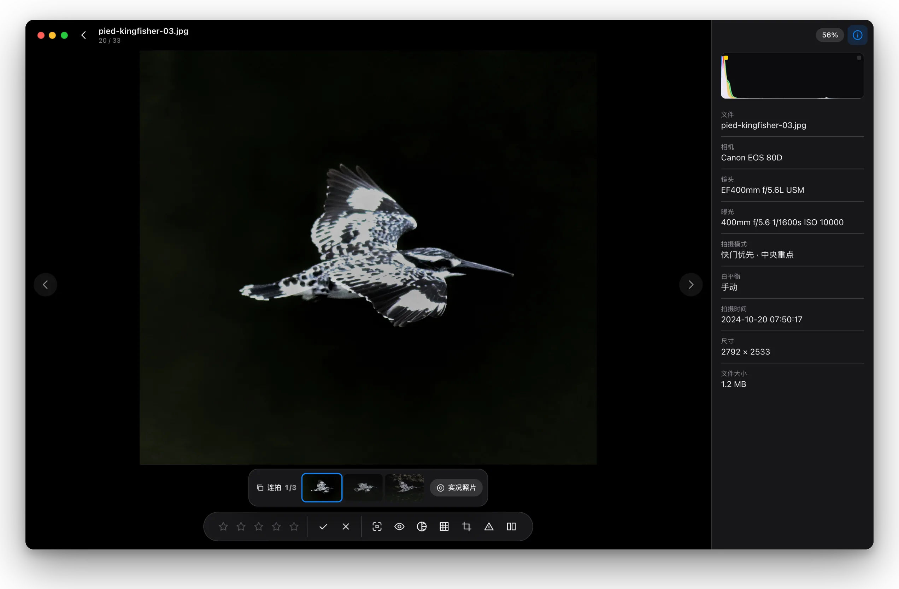</td>
<td width="50%">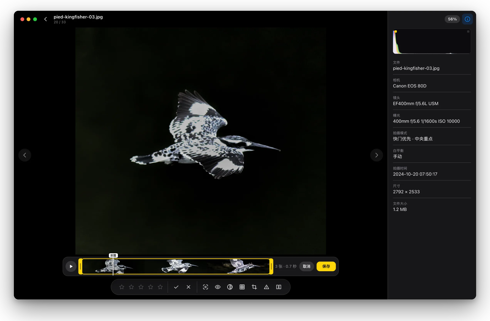</td>
</tr>
</table>

## 滤镜

导入 `.cube`、`.3dl`、HaldCLUT `.png` 和尼康 `.NP3`，按 `W` 在一张照片上同时看全部滤镜，点一下即套用；在列表里选中多张可以一次套好。有 RAW 的照片从 RAW 渲染，不会叠在机内色彩风格上；用云创 / 自定义配方拍的照片，可以把配方取出来存成 NP3，套到别的照片上。

<p align="center">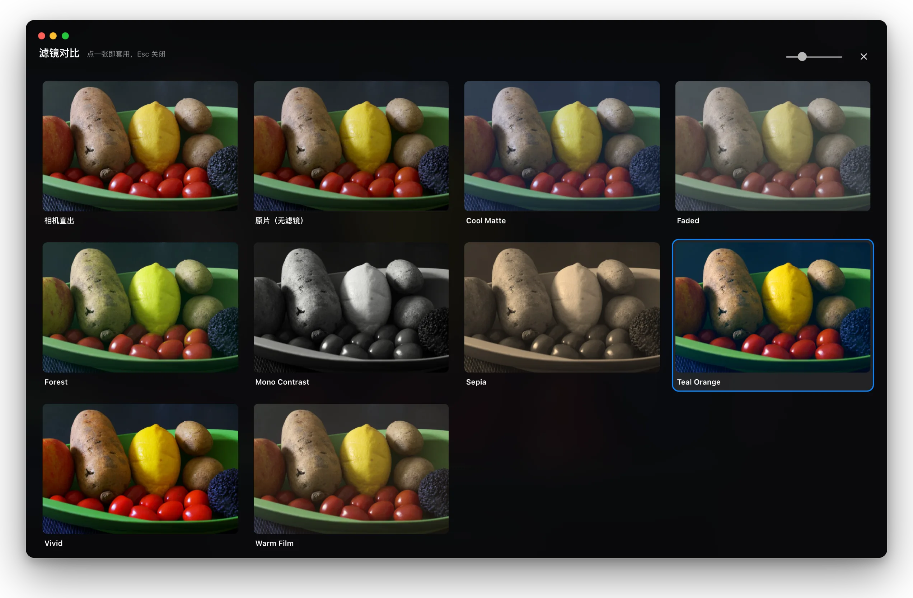</p>

**尼康官方引擎**：官方的 macOS 和 64 位 Windows 安装包内置了尼康 NEF/NRW Image SDK，NEF 的原片和 NP3 滤镜由尼康自己的引擎渲染，自定义曲线也一样，和机内直出一致。这部分经尼康授权随 Sift 分发，不是开源软件，条款见 [NIKON_SDK_TERMS.md](NIKON_SDK_TERMS.md)；自己从源码构建的版本不含它，NP3 按参数近似还原，其余功能不受影响。

## 对比与曝光

按 `C` 左右对比两张，缩放和平移可以同步；按 `H` 在画面上标出过曝（红）和欠曝（蓝），阈值和直方图一致。

<table>
<tr>
<td width="50%">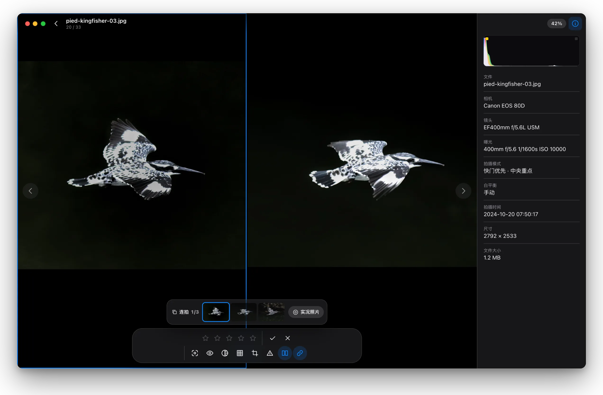</td>
<td width="50%">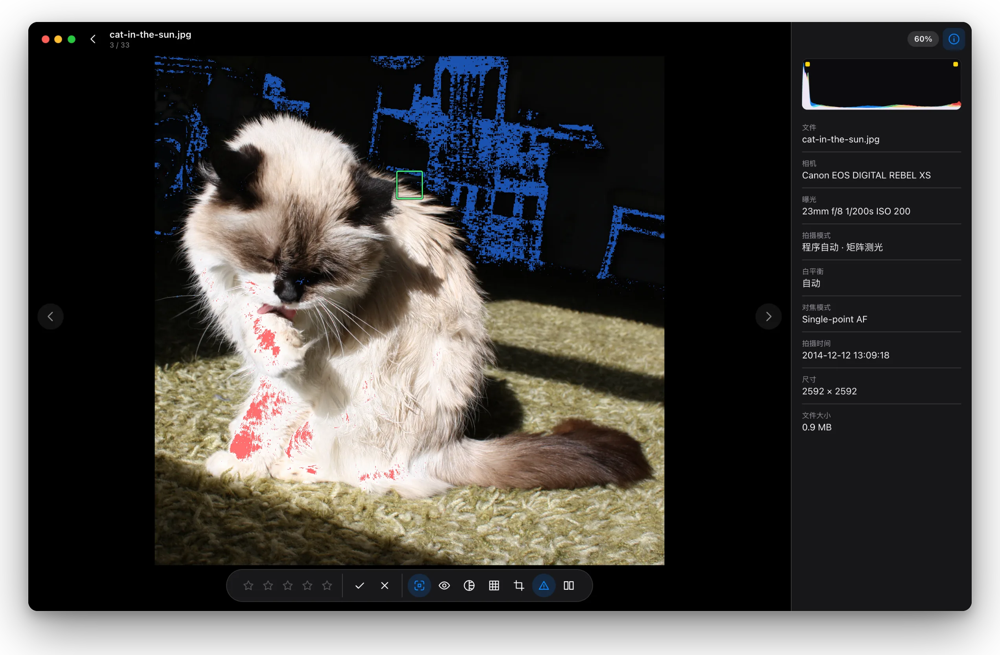</td>
</tr>
</table>

## 从列表捏合进照片

`Ctrl` + 滚轮或者双指捏合缩放缩略图，放到一行两张后继续放大就打开指针下的那张，在查看页里继续缩小又回到列表。

<p align="center">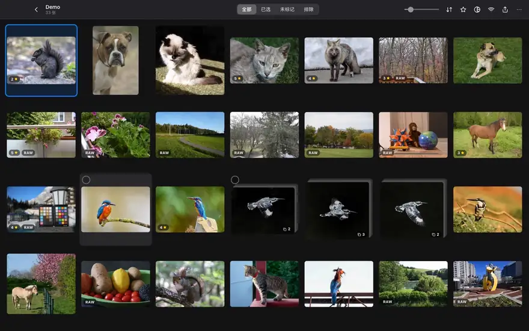</p>

## 导出与传到手机

选好的照片可以复制、按规则重命名、按选片结果找回对应的 RAW，或者加一条带拍摄参数的相框导出；套了滤镜或裁剪的导出为渲染好的 JPEG，其余原样复制。局域网传输让手机扫码下载原片，也能把手机上的照片发回电脑。

<p align="center">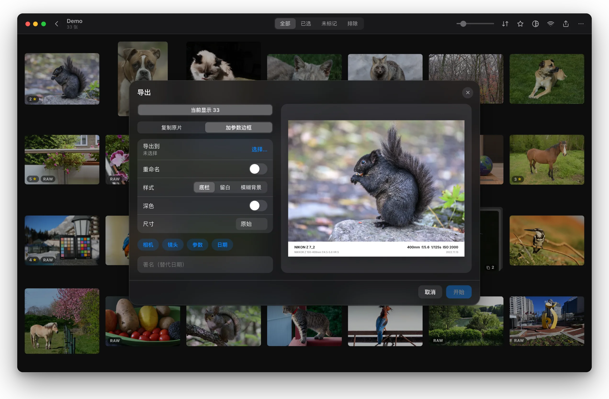</p>

## Windows、浅色模式和手机

<table>
<tr>
<td width="62%">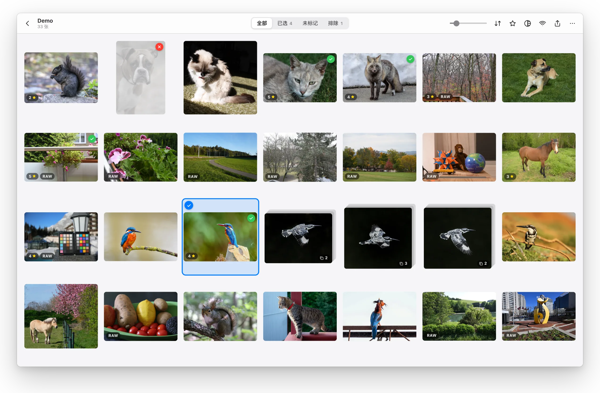</td>
<td width="38%">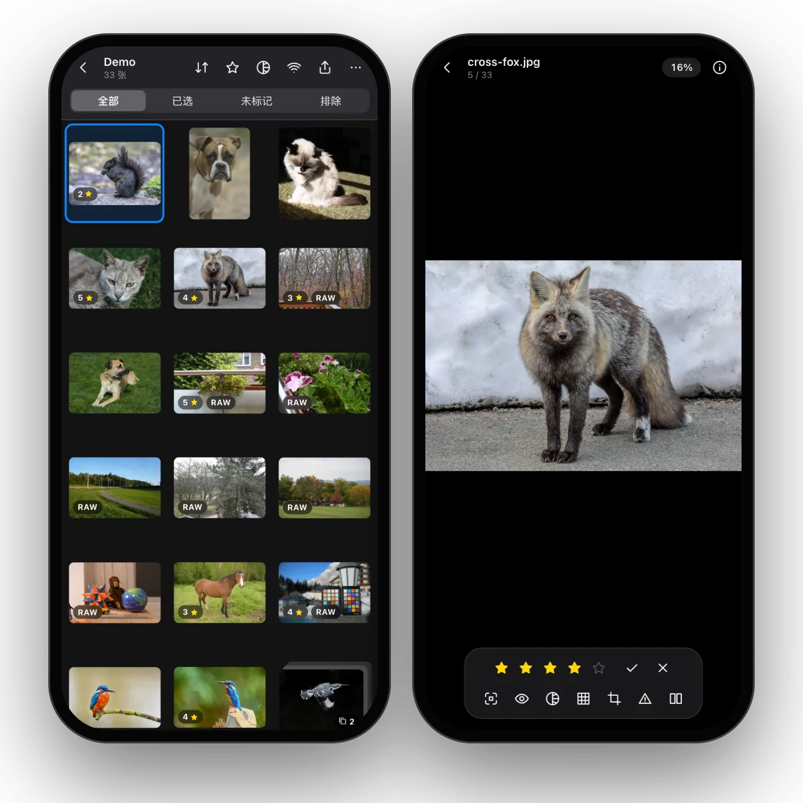</td>
</tr>
</table>

## 性能

在 Apple M4（16 GB）上用 release 构建测得，照片放在 USB 外接 SSD 上。

| 操作 | 耗时 | 怎么测的 |
| --- | --- | --- |
| 从 RAW 里取出内嵌的全尺寸预览 | 中位 0.2 ms，最慢 0.9 ms | 32 个尼康 / 佳能 / 索尼样张，文件已在系统缓存中 |
| 生成一张缩略图（长边 480 px） | 中位 5 ms，最慢 37 ms | 同上 |
| 打开 990 张照片的文件夹，到第一屏缩略图全部显示 | 0.64 s | 缩略图缓存清空后，界面里实测 |
| 在查看页按 `→` 换到下一张 | 中位 8 ms，最慢 15 ms | 33 张 RAW 和 JPEG 混合，界面里实测 |
| 停下后换上全尺寸原图 | 约 150–170 ms，个别 RAW 0.3–0.7 s | 含有意等待的 140 ms |
| 对照：完整解码一张 RAW 并编码成 JPEG | 0.5–2.0 s，中位 0.8 s | 8 款机身，rawler 和 ImageIO 都测了 |

界面里的数字来自 [`scripts/readme-shots.mjs`](scripts/readme-shots.mjs) 的 `perf`，核心的数字来自 `cargo run --release -p sift-core --example probe -- --preview <目录> <文件…>`。

## 下载

在 [Releases](https://github.com/kinyokun/sift/releases/latest) 下载：

- macOS（Apple 芯片和 Intel 通用）：`Sift_<版本>_universal.dmg`
- Windows 10 / 11（64 位）：`Sift_<版本>_x64-setup.exe`

安装包目前没有经过 Apple 公证 / 微软签名：

- macOS 首次打开若提示无法验证开发者，到 “系统设置 → 隐私与安全性” 底部点 “仍要打开”
- Windows 若出现 SmartScreen 提示，点 “更多信息 → 仍要运行”

每个 Release 附有 `SHA256SUMS.txt` 可校验文件。iOS 和 Android 版目前需要自己构建，见 [AGENTS.md](AGENTS.md)。

## 全部功能

**选片**

- 网格浏览与全屏查看，RAW+JPEG 自动配对成一张；可按文件名、拍摄时间、星级、文件大小排序
- 连拍和像素偏移拍摄的照片自动叠成一组，查看页里可在组内逐张挑；实况照片显示成一张并可播放，macOS 上可以用连拍做实况照片
- 多选：点照片左上角的圆圈逐张勾选，按住鼠标拖动框选，Shift 选一段，⌘/Ctrl 点选；选中多张后底部出现操作栏，可一次打星、标记、套滤镜。手机上长按照片进入多选
- 选中 / 排除 / 0–5 星；星级写入文件内的 XMP（写不进去时写 `.xmp` 旁车文件），RAW 文件本身从不改写
- 100% 查看、眼部特写（人眼，以及猫、狗、鸟、马、羊、牛等动物的眼睛）、对焦点显示（尼康、佳能、索尼、富士）
- 左右对比两张照片，可同步缩放和平移
- 构图线、裁剪预览（确认后导出时生效）
- 直方图，以及画面上的过曝 / 欠曝警告
- 进度按文件夹自动保存，下次打开接着选

**滤镜**

- 导入 `.cube`、`.3dl`、HaldCLUT `.png` 和尼康 `.NP3`
- 有 RAW 的照片从 RAW 渲染，不会叠在机内风格上
- 滤镜对比墙、批量套用、把照片里的云创 / 自定义配方存成 NP3
- 套了滤镜或裁剪的照片导出为渲染后的 JPEG，其余原样复制

**其他**

- 导出：复制 / 重命名、按文件名找回 RAW、带参数的相框
- 局域网传输：手机扫码下载原片或把照片发回电脑
- 快捷键全部可改（设置 → 快捷键）

<details>
<summary><b>常用快捷键</b></summary>

- `A` / `D` 或 `←` / `→`：上一张 / 下一张
- `↑` / `↓`：上一组 / 下一组（连拍、像素偏移）
- `P` / `X` / `U`：选中 / 排除 / 取消标记
- `0`–`5`：星级
- `Z`：100% / 适合窗口
- `E`：眼部特写
- `F`：对焦点
- `N`：原片（无滤镜）
- `⌘A` / `⌘D`：上一个 / 下一个滤镜（Windows 为 Ctrl）
- `W`：滤镜对比墙
- `H`：过曝 / 欠曝警告
- `C`：对比
- `R`：裁剪预览
- `I`：信息栏
- `空格`：隐藏界面
- `` ` ``：全部快捷键

</details>

## 支持的格式

| 类型 | 格式 |
| --- | --- |
| 图片 | JPEG、PNG、WebP、BMP、GIF、TIFF |
| RAW | CR3、CR2、NEF、NRW、ARW、SR2、SRF、DNG、RAF、ORF、RW2、PEF、3FR、IIQ、ERF、SRW |
| 对焦点 | 尼康、佳能、索尼、富士 |
| 滤镜 | `.cube`、`.3dl`、HaldCLUT `.png`、尼康 `.NP3` |

尼康 High Efficiency（HE / HE\*）NEF 的“无滤镜原片”在 Apple 平台用系统解码器；Windows 和 Android 自带的解码器读不了这种文件，仍可用内嵌预览选片。

## 构建

Sift 由 Rust 核心、Tauri 2 外壳和 React/TypeScript 界面组成。需要 Rust（stable）、Node 22、pnpm。

```bash
pnpm install
```

```bash
pnpm tauri dev
```

```bash
pnpm tauri build
```

- macOS 安装包在 `target/release/bundle/dmg/`，Windows 在 `target/release/bundle/nsis/`
- 每次推送和 pull request，GitHub Actions 都会构建一个 Windows 测试安装包，在该次运行的 Artifacts 里下载
- 正式版本由推送 `v*` 标签触发构建，流程见 [CONTRIBUTING.md](CONTRIBUTING.md#发版)
- iOS / Android 的命令见 [AGENTS.md](AGENTS.md)

## 开发

```bash
cargo test -p sift-core
```

```bash
cargo clippy --workspace
```

```bash
pnpm typecheck
```

目录：

- `crates/sift-core`：不依赖界面的核心。容器解析、内嵌预览、EXIF、对焦点、星级、人脸与动物检测、RAW 显影、滤镜、尼康引擎、直方图、导出
- `src-tauri`：命令、`sift://` 图片协议、局域网传输
- `src`：界面。状态在 `lib/store.ts`，文案在 `lib/i18n.ts`（中 / 英）

检查单个文件、无窗口截图检查界面的方法，以及容易踩的坑，都写在 [AGENTS.md](AGENTS.md)。这页的截图和动图怎么生成见 [docs/readme](docs/readme/README.md)。参与贡献请看 [CONTRIBUTING.md](CONTRIBUTING.md)，安全问题请按 [SECURITY.md](SECURITY.md) 私下报告。

## 致谢

Sift 起源于 [Anicrop Studio](https://github.com/R4ksh4/AnicropStudio)（R4ksh4，Apache-2.0）——一个为漫展返图打造的 Windows 选片工作台。Sift 用 Rust 和 TypeScript 重写了它，带到 macOS、Windows、iOS 和 Android 上；眼部特写、原厂对焦点、文件内打星、按选片找回 RAW、对比、构图线、参数相框这些功能和思路都来自 Anicrop Studio。

- [Anicrop Studio](https://github.com/R4ksh4/AnicropStudio)：Sift 的起点，作者 R4ksh4 及其贡献者（Apache-2.0）
- [rawler / dnglab](https://github.com/dnglab/dnglab)：RAW 显影（LGPL-2.1）
- [tract](https://github.com/sonos/tract)：在本机运行识别模型
- [Tauri](https://tauri.app)、[React](https://react.dev)、[zustand](https://github.com/pmndrs/zustand)
- [raw.pixls.us](https://raw.pixls.us)：测试用样张
- 本页截图里的动物照片来自 Wikimedia Commons，均为 CC0，作者见 [docs/readme](docs/readme/README.md#照片来源)
- 识别模型与字体见下方

## 许可

Sift 以 [GPL-3.0-or-later](LICENSE) 许可开源：可以自由使用、修改和再分发，但分发修改版或基于 Sift 的作品时，必须同样以 GPL-3.0 开源并提供完整源码。版权、来源声明和附加许可见 [NOTICE](NOTICE)，第三方组件见 [THIRD_PARTY_NOTICES.md](THIRD_PARTY_NOTICES.md)；每个 Release 附带全部 Rust 依赖的许可全文 `THIRD-PARTY-LICENSES.html`。

Anicrop Studio 采用 Apache-2.0，Apache-2.0 允许其衍生作品以 GPL-3.0 分发；所用依赖（含 LGPL-2.1 的 rawler、MPL-2.0 的若干 crate）都与 GPL-3.0 兼容。

尼康 SDK 归尼康所有，经尼康授权内置在官方安装包里，不适用 GPL，使用条款见 [NIKON_SDK_TERMS.md](NIKON_SDK_TERMS.md)；驱动它的 `sift-nikon` 程序因尼康许可的保密条款无法公开源码，是一个独立的可执行文件，Sift 通过本机套接字和它通信。NOTICE 里按 GPL-3.0 第 7 条附加了一条许可，允许这样组合分发。Nikon、Canon、Sony、Fujifilm 等是各自所有者的商标，Sift 与这些公司没有关联。

随应用分发的识别模型与字体（在 `crates/sift-core/assets`）：

- YuNet 人脸检测（OpenCV Zoo，MIT）
- YOLOX-Tiny 物体检测（Megvii，Apache-2.0），用来找动物
- RTMPose-m AP-10K 动物关键点（OpenMMLab MMPose，Apache-2.0；AP-10K 数据集为 CC BY 4.0），用来找动物的眼睛
- Inter 字体（SIL OFL 1.1），用于参数相框
